

  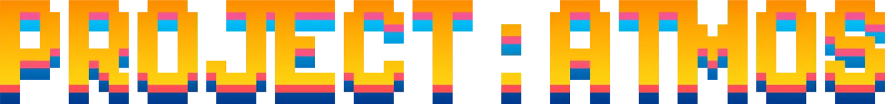

<h3 align="center">Cinematic atmosphere for OpenRCT2. Volumetric clouds, weather, soft shadows, dynamic lights, tilt-shift and colour grading, rendered live inside the game.</h3>

  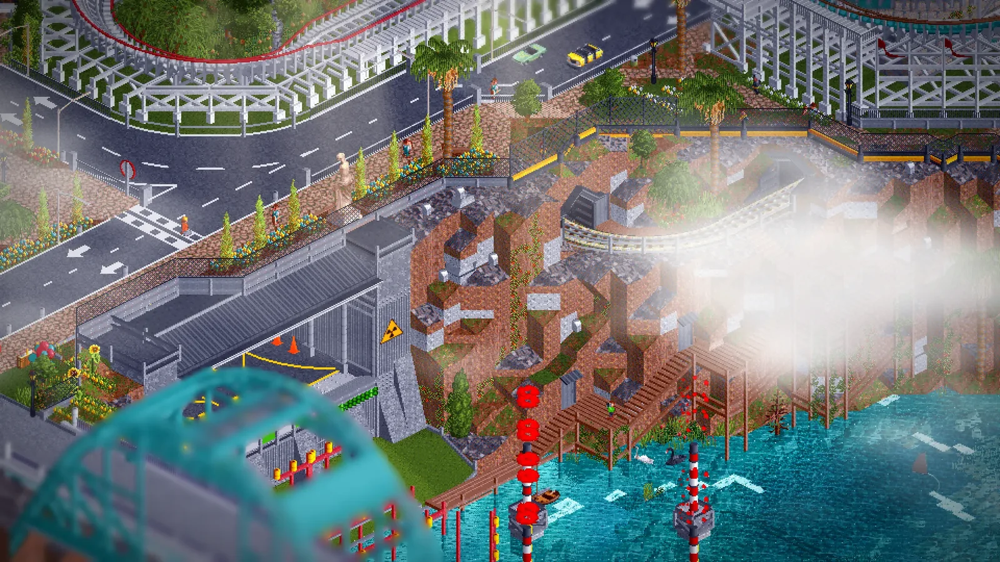

> **Unofficial fork.** Project:Atmos is a fan-made fork of [OpenRCT2](https://github.com/OpenRCT2/OpenRCT2). It is not an official OpenRCT2 release and is not affiliated with or supported by the OpenRCT2 team, Atari or Chris Sawyer. **Please do not report problems of this build to OpenRCT2.** Use the issues of this repository instead.

By [ROYR](https://royr.clubroy.art/) · [Website and park archive](https://royr.clubroy.art/) · [Downloads](../../releases)

## What it does

Every image on this page is a raw in-game screenshot. No effects were added in post.

| | |
|:--|:--|
| 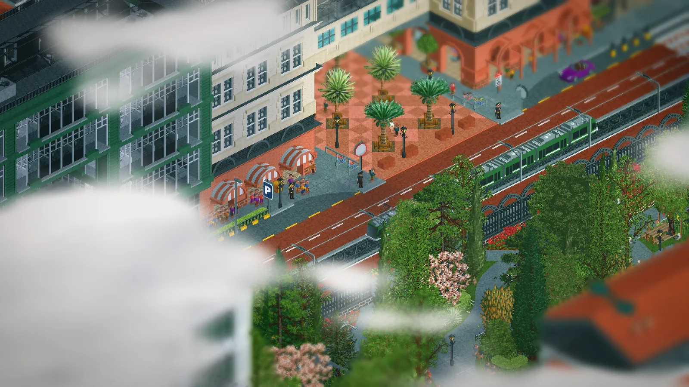 **Volumetric clouds** that react to sun and weather and cast soft shadows. | 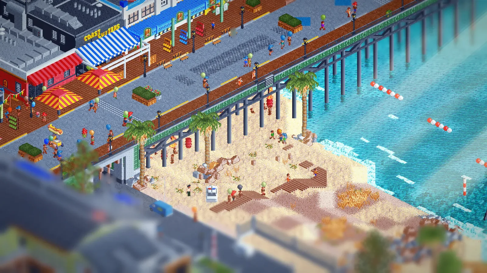 **Sun rays** that follow the time of day and the camera. |
| 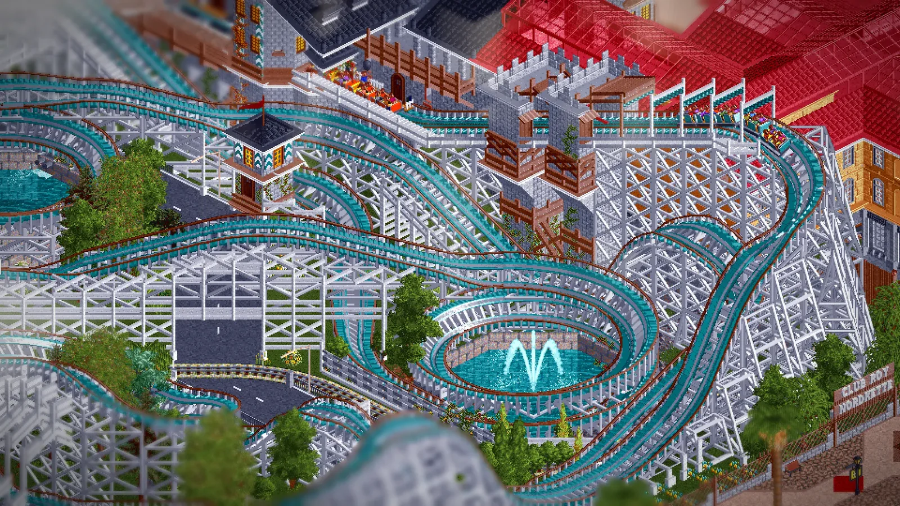 **Tilt-shift** with real scene depth, plus vignette. | 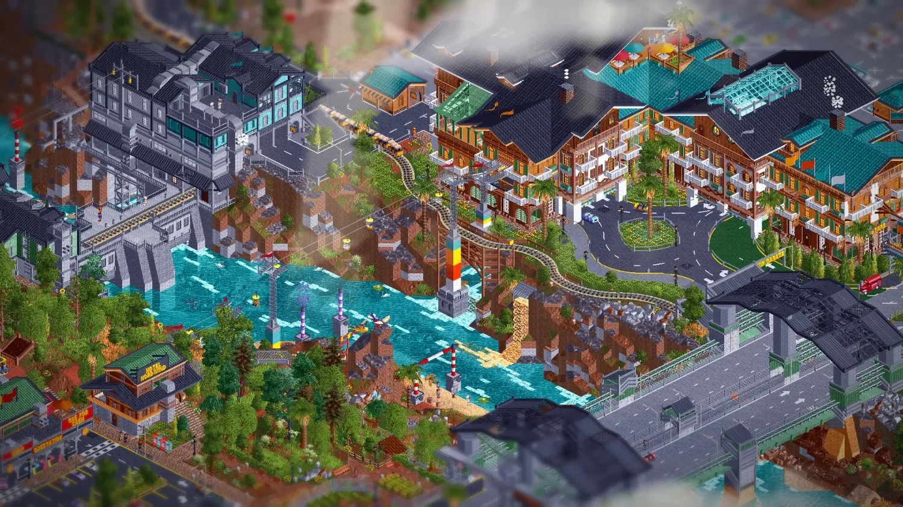 **Colour grading and cinema looks**, with `.cube` LUT support. |

- Rain, snow, fog and lightning with their own rendering
- Day/night cycle, glowing lamps and freely placed light objects (saved per park)
- Soft shadows for guests, staff, vehicles and tracks; swaying trees; falling leaves
- A settings window with the tabs *Effects, Sun, Time, Sky, Weather, Water, Colour, LUTs, Cinema, Lights* (hotkey `Ctrl+Shift+A`)

  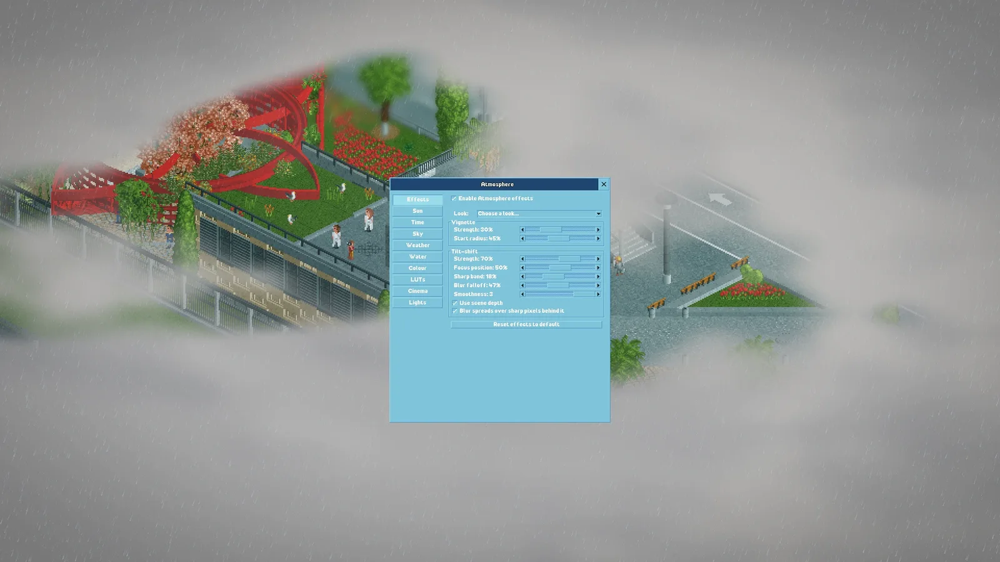

## Screenshots

**Club ROY 97 – Beilui West**

| | | |
|:--|:--|:--|
| 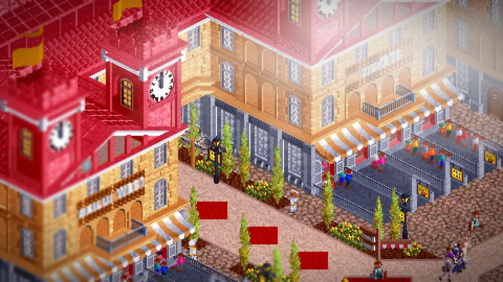 | 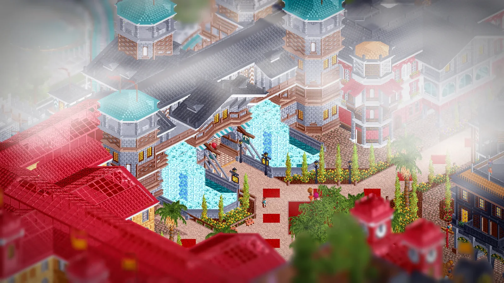 |  |

**Pacific Ocean Park**

| | | |
|:--|:--|:--|
| 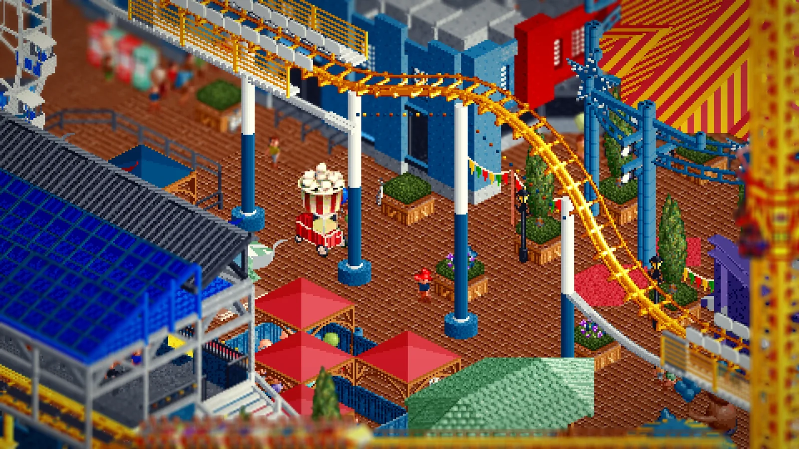 | 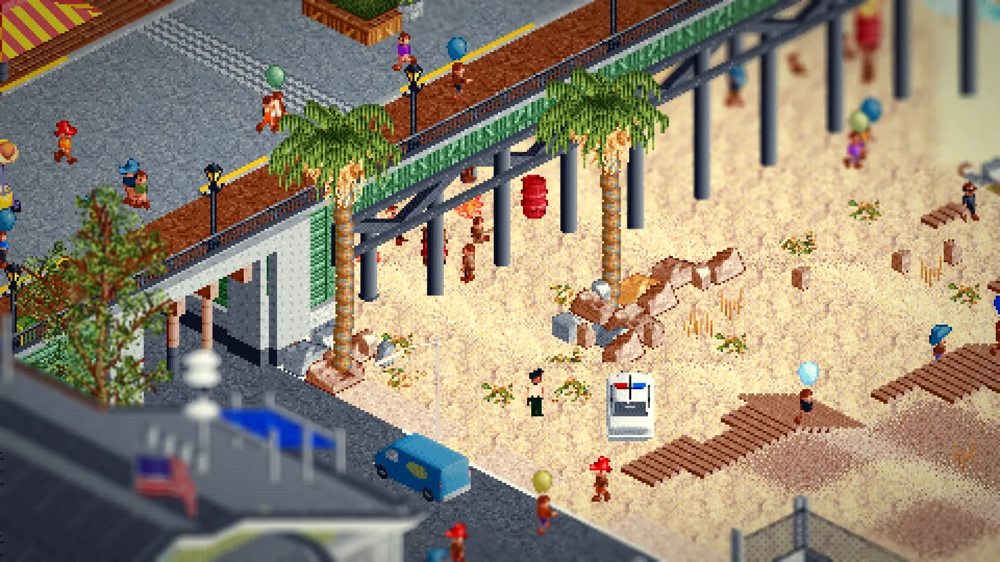 | 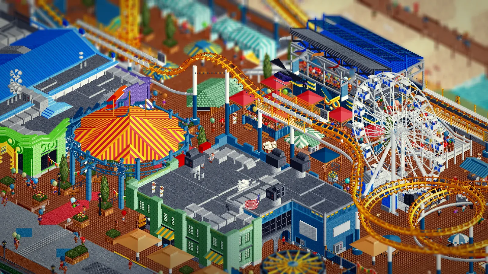 |

More parks and shots in the [ROYR archive](https://royr.clubroy.art/projects/).

## Install (Windows, portable)

1. Download `Project-Atmos-<version>-win64.zip` from the [Releases](../../releases) page and unzip it anywhere.
2. You need your own copy of **RollerCoaster Tycoon 2** (for example from GOG or Steam). Its game files are **not** included. On the first start, point the game to your RCT2 folder.
3. Start `Start-Project-Atmos.cmd`. Settings and saves live in the `userdata` folder next to it.

Windows SmartScreen or your antivirus may warn about the unsigned `Project-Atmos.exe`. Compare the SHA-256 checksum from the release page before running it.

## Good to know

- Shadows are a geometric approximation, not full 3D silhouettes.
- Performance is not fully optimised yet. With every effect on, expect roughly 12 ms per frame at 1080p.
- Technical notes and known limits: [`docs/project-atmos/`](docs/project-atmos/).

## Build

See [`BUILDING.md`](BUILDING.md).

## License and credits

Project:Atmos is licensed under the **GNU General Public License v3.0**, like OpenRCT2 (see [`licence.txt`](licence.txt)). The source of every release is the tagged commit of this repository. OpenRCT2 contributors are listed in [`contributors.md`](contributors.md); the upstream readme is kept in [`docs/upstream/OpenRCT2-README.md`](docs/upstream/OpenRCT2-README.md).

RollerCoaster Tycoon and RollerCoaster Tycoon 2 are trademarks of Atari / Chris Sawyer. All original game assets belong to their respective owners. Parks shown are by ROYR.
